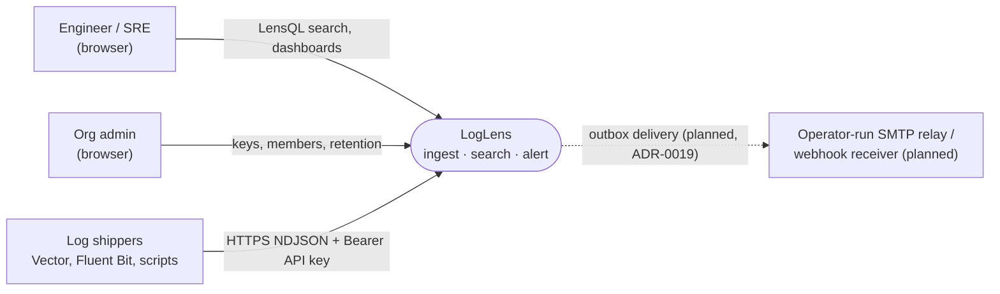
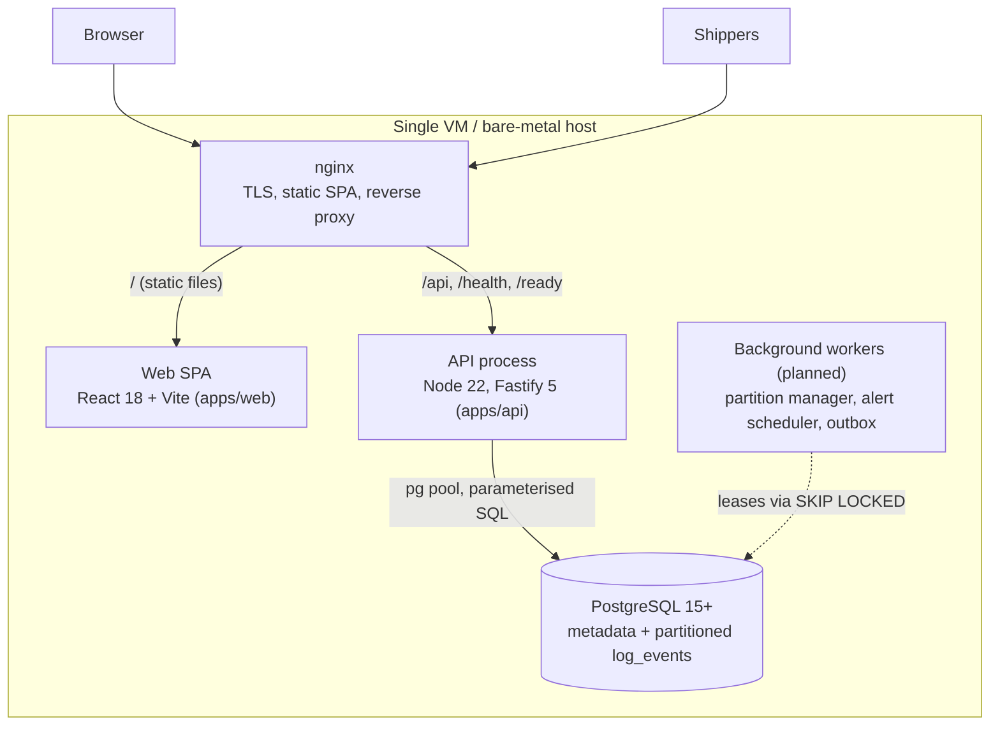
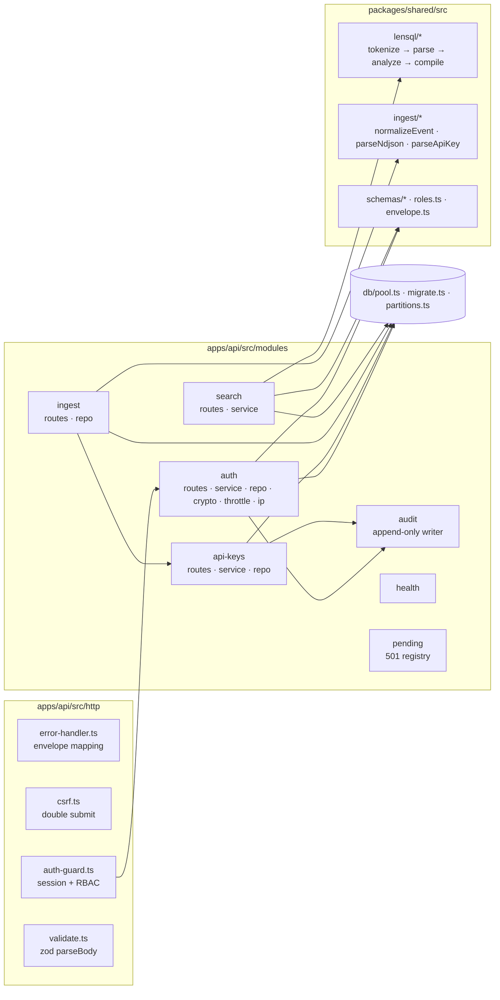

# Architecture overview

LogLens is a self-hosted log platform: shippers push events over HTTP, the events are stored in time-partitioned PostgreSQL tables, and users explore them with **LensQL**, an in-house query language compiled to parameterised SQL. Alerting, dashboards, live tail and pipelines are planned (see [roadmap](../planning/roadmap.md)). This document describes the system with C4 diagrams, module boundaries and the lifecycle of the two hot requests: search and ingest.

Implemented today (M0–M2): foundation, authentication, ingestion keys, NDJSON/JSON ingestion into partitions, LensQL search/stats/histogram, and the search UI. Everything marked _planned_ below answers `501 NOT_IMPLEMENTED` with its ticket id.

## C4 level 1 — system context



There are no outbound calls to third-party services. Notifications (planned) are written to a local outbox and delivered only to endpoints the operator configures.

## C4 level 2 — containers



| Container         | Tech                                     | Responsibility                                                                                |
| ----------------- | ---------------------------------------- | --------------------------------------------------------------------------------------------- |
| Web SPA           | React 18, React Router, plain CSS tokens | Login/register, app shell with Planned badges, search screen, ingestion keys screen           |
| API               | Fastify 5, `pg`, zod, pino               | Auth, RBAC, CSRF, ingestion, LensQL compile + execute, audit, health, pending 501 routes      |
| Shared package    | Pure TypeScript (`packages/shared`)      | LensQL lexer/parser/analyzer/compiler, histogram math, event normalisation, schemas, roles    |
| PostgreSQL        | 15+ with `pg_trgm`                       | All state: tenants, users, sessions, audit, API keys, daily `log_events_pYYYYMMDD` partitions |
| Workers (planned) | Same codebase, separate systemd units    | Partition maintenance (LG-191), alert evaluation (LG-161), outbox delivery (LG-171)           |

## C4 level 3 — API components



### Module boundaries

- **`packages/shared`** has no I/O. It may not import Node or browser APIs (except `TextEncoder`). The compiler is a pure function `compileQuery(query, ctx) → { text, values, columns, mode, range, limit }`; executing SQL is the API's job.
- **API modules** own their routes, services and repositories. Cross-module calls go through exported functions (`authenticateApiKey`, `writeAudit`); no module reads another module's tables directly except through those functions.
- **Repositories** always take `organizationId` explicitly (ADR-0006). The tenant id comes from `request.auth` (session) or from the API key record, never from the request body.
- **`http/`** contains cross-cutting Fastify hooks; it has no domain logic.
- **Pending modules** (pipelines, dashboards, alerts, incidents, retention, members) are represented only by `modules/pending/pending.routes.ts` until implemented.

## Request lifecycle — search

```mermaid
sequenceDiagram
  autonumber
  participant B as Browser (SearchPage)
  participant F as Fastify hooks
  participant G as auth-guard
  participant S as search.service
  participant C as shared compiler
  participant P as PostgreSQL
  B->>F: POST /api/v1/search {query, from, to}<br/>cookie ll_session, header x-csrf-token
  F->>F: genReqId, CSRF double-submit check
  F->>G: preHandler requireAuth('search:read')
  G->>P: SELECT session ⋈ user ⋈ org ⋈ membership WHERE token_hash = sha256(cookie)
  P-->>G: SessionContext (organizationId, role)
  G-->>S: request.auth
  S->>S: zod searchRequestSchema (strict)
  S->>C: compileQuery(query, {organizationId, range, now, limits})
  C->>C: tokenize → parse (spans) → analyze stages → resolve time range
  C-->>S: { text with $1..$n, values, columns, mode }
  S->>P: BEGIN READ ONLY; set_config('statement_timeout', 5000, true)
  S->>P: execute statement (tenant + time predicate first → partition pruning)
  P-->>S: rows
  S->>P: COMMIT
  S-->>B: 200 { data: {mode, columns, rows, range, stats} }
  Note over S,B: LensQLError → 422 QUERY_INVALID with span;<br/>57014 → 422 QUERY_TIMEOUT
```

The histogram request follows the same path with `compileHistogram`, after which `fillHistogram` densifies the sparse rows into a gap-free series aligned to the Unix epoch (matching `date_bin`).

## Request lifecycle — ingest

```mermaid
sequenceDiagram
  autonumber
  participant SH as Shipper
  participant F as Fastify (ingest scope)
  participant K as api-keys.service
  participant N as shared normaliser
  participant PK as partition keeper
  participant P as PostgreSQL
  SH->>F: POST /api/v1/ingest (NDJSON, Authorization: Bearer llk_…)
  F->>F: body limit 5 MiB, NDJSON parsed as string (CSRF exempt)
  F->>K: authenticateApiKey(bearer)
  K->>P: SELECT … FROM api_keys WHERE prefix = $1
  K->>K: sha256(token) vs stored digest (timingSafeEqual; dummy digest if unknown)
  K-->>F: key {organizationId, defaultService} or 401
  F->>N: parseNdjson(body, receivedAt, maxEvents)
  N-->>F: events[] + rejected[{line, reason}] (or 413 over cap)
  F->>PK: ensure daily partitions (once per UTC day)
  F->>P: INSERT INTO log_events SELECT … FROM unnest($3::timestamptz[], …, $10::jsonb[])
  P-->>F: rowCount (routed to log_events_pYYYYMMDD)
  F->>P: UPDATE api_keys SET last_used_at (≤ once/min)
  F-->>SH: 202 {accepted, rejectedCount, rejected[≤50]}
```

## Cross-cutting concerns

| Concern          | Implementation                                                                                                                                                              |
| ---------------- | --------------------------------------------------------------------------------------------------------------------------------------------------------------------------- |
| Configuration    | `apps/api/src/config/env.ts` validates env with zod at startup and lists every problem; `TRUST_PROXY` explicit, required in production (NFR-020).                           |
| Error handling   | `AppError` for expected failures; `registerErrorHandler` maps everything to `{ data: null, error: { code, message, details? } }`; unknown errors log with request id → 500. |
| Logging          | pino JSON logs with request ids; `cookie`, `authorization`, `x-csrf-token` and `set-cookie` are redacted (NFR-011).                                                         |
| Request ids      | Incoming `x-request-id` accepted if it matches `[A-Za-z0-9._-]{8,64}`, otherwise a UUID; echoed in the response and written to audit rows.                                  |
| Security headers | `x-content-type-options: nosniff`, `referrer-policy: no-referrer`, `cache-control: no-store` on every API response; CSP hardening is LG-217.                                |
| Auth & RBAC      | Session cookie + CSRF double submit (ADR-0007), throttling (ADR-0008), role → permission table in `packages/shared/src/roles.ts`.                                           |
| Audit            | `writeAudit` appends to `audit_events`; a trigger blocks `UPDATE`/`DELETE`.                                                                                                 |
| Tenancy          | `organization_id` on every tenant row and as the first predicate of every compiled search (ADR-0006).                                                                       |
| Time             | All timestamps `timestamptz` in UTC; partitions are UTC days; relative LensQL times resolve against an injected `now`.                                                      |
| Testing          | Pure shared logic unit tested; API tested through `app.inject` against a real PostgreSQL test database; see [test strategy](../testing/test-strategy.md).                   |

## Scaling path

1. Vertical: one API process and PostgreSQL on the same host handle the M2 target load (to be measured by LG-102/LG-221).
2. Split ingest and query processes (same build, different registered modules) behind nginx; move limiter counters to PostgreSQL first (LG-216).
3. Add workers for alerting and partition management as separate systemd units using `SKIP LOCKED` leases (ADR-0017).
4. Read replica for search traffic; the compiler output is backend-agnostic SQL so the search service can target a replica pool.
