# Data Model

PostgreSQL (15+) is the only datastore (ADR-0004). All timestamps are `timestamptz` in UTC. Every
tenant-owned table carries `organization_id`, and every query filters on it in the repository
layer or in the LensQL compiler (ADR-0006).

Migration status:

| Migration                        | Status  | Creates                                                                                                                         |
| -------------------------------- | ------- | ------------------------------------------------------------------------------------------------------------------------------- |
| `0001_foundation.sql`            | applied | `organizations`, `users`, `memberships`, `sessions`, `audit_events` (+ append-only trigger), `pgcrypto`                         |
| `0002_ingestion_and_search.sql`  | applied | `pg_trgm`, `api_keys`, partitioned `log_events`, `log_events_default`, `loglens_ensure_daily_partitions()`                      |
| `0003_ingest_controls` (planned) | planned | `ingest_quotas`, `ingest_usage_daily`, `dead_letter_events` (LG-105, LG-112)                                                    |
| `0004_pipelines` (planned)       | planned | `pipelines`, `pipeline_processors` (LG-120)                                                                                     |
| `0005_saved_searches_dashboards` | planned | `saved_searches`, `dashboards`, `dashboard_panels` (LG-130, LG-150)                                                             |
| `0006_alerting`                  | planned | `alert_rules`, `alert_rule_state`, `alert_events`, `notification_channels`, `outbox_messages`, `notifications` (LG-160..LG-172) |
| `0007_incidents`                 | planned | `incidents`, `incident_events` (LG-180)                                                                                         |
| `0008_retention`                 | planned | `retention_policies`, `partition_archive` (LG-190..LG-192)                                                                      |
| `0009_identity_extensions`       | planned | `invitations`, `login_attempts`, `mfa_factors`, `password_reset_tokens`, `email_verifications` (LG-201, LG-210..LG-216)         |

## Target ERD

```mermaid
erDiagram
  organizations ||--o{ memberships : has
  users ||--o{ memberships : has
  users ||--o{ sessions : owns
  organizations ||--o{ sessions : scopes
  organizations ||--o{ audit_events : records
  users ||--o{ audit_events : acts
  organizations ||--o{ api_keys : issues
  api_keys ||--o{ log_events : ingests
  organizations ||--o{ log_events : owns
  organizations ||--o{ invitations : sends
  organizations ||--|| ingest_quotas : limits
  organizations ||--o{ ingest_usage_daily : meters
  organizations ||--o{ dead_letter_events : rejects
  organizations ||--o{ pipelines : configures
  pipelines ||--o{ pipeline_processors : contains
  organizations ||--o{ saved_searches : stores
  users ||--o{ saved_searches : authors
  organizations ||--o{ dashboards : owns
  dashboards ||--o{ dashboard_panels : contains
  saved_searches ||--o{ dashboard_panels : backs
  organizations ||--o{ alert_rules : defines
  alert_rules ||--o{ alert_rule_state : tracks
  alert_rules ||--o{ alert_events : emits
  alert_rules }o--o{ notification_channels : notifies
  notification_channels ||--o{ outbox_messages : queues
  users ||--o{ notifications : receives
  alert_events }o--o| incidents : opens
  incidents ||--o{ incident_events : timeline
  organizations ||--|| retention_policies : retains
  organizations ||--o{ partition_archive : archives
  users ||--o{ mfa_factors : enrolls
  users ||--o{ password_reset_tokens : requests
  users ||--o{ email_verifications : verifies

  organizations {
    uuid id PK
    text name
    text slug UK
    timestamptz created_at
  }
  users {
    uuid id PK
    text email "unique lower(email)"
    text name
    text password_hash "scrypt$N$r$p$salt$hash"
    timestamptz last_login_at
  }
  memberships {
    uuid organization_id PK,FK
    uuid user_id PK,FK
    text role "owner|admin|member|viewer"
  }
  sessions {
    uuid id PK
    text token_hash UK "sha256 hex"
    uuid user_id FK
    uuid organization_id FK
    timestamptz expires_at
    timestamptz last_seen_at
    text ip
    text user_agent
  }
  audit_events {
    bigserial id PK
    uuid organization_id FK
    uuid actor_user_id FK
    text action
    text target_type
    text target_id
    jsonb metadata
    text request_id
  }
  api_keys {
    uuid id PK
    uuid organization_id FK
    text name
    text prefix UK
    text key_hash "sha256 hex"
    text default_service
    timestamptz last_used_at
    timestamptz revoked_at
  }
  log_events {
    bigserial id PK
    timestamptz timestamp PK "partition key"
    uuid organization_id
    uuid api_key_id
    timestamptz received_at
    text level
    text service
    text host
    text source
    text message
    text trace_id
    jsonb attributes
  }
  invitations {
    uuid id PK
    uuid organization_id FK
    text email
    text role
    text token_hash
    timestamptz expires_at
    timestamptz accepted_at
  }
  ingest_quotas {
    uuid organization_id PK,FK
    bigint max_events_per_day
    bigint max_bytes_per_day
  }
  ingest_usage_daily {
    uuid organization_id PK,FK
    date day PK
    bigint events
    bigint bytes
    bigint rejected
  }
  dead_letter_events {
    bigserial id PK
    uuid organization_id FK
    uuid api_key_id FK
    text reason
    text raw
    timestamptz received_at
  }
  pipelines {
    uuid id PK
    uuid organization_id FK
    text name
    jsonb match "LensQL filter"
    int position
    boolean enabled
  }
  pipeline_processors {
    uuid id PK
    uuid pipeline_id FK
    int position
    text kind "grok|rename|drop|coerce"
    jsonb config
  }
  saved_searches {
    uuid id PK
    uuid organization_id FK
    uuid owner_id FK
    text name
    text query
    text time_preset
    text visibility "private|org"
  }
  dashboards {
    uuid id PK
    uuid organization_id FK
    text title
    jsonb variables
    jsonb layout
  }
  dashboard_panels {
    uuid id PK
    uuid dashboard_id FK
    uuid saved_search_id FK
    text title
    text query
    text chart "line|area|bar|table"
    jsonb position
  }
  alert_rules {
    uuid id PK
    uuid organization_id FK
    text name
    text query
    text kind "threshold|ewma"
    jsonb condition
    interval every
    interval for_duration
    timestamptz next_run_at
    boolean enabled
  }
  alert_rule_state {
    uuid rule_id PK,FK
    text group_key PK
    text state "ok|pending|firing|resolving|silenced"
    double ewma_mean
    double ewma_var
    int flap_count
    timestamptz changed_at
  }
  alert_events {
    bigserial id PK
    uuid rule_id FK
    text group_key
    text from_state
    text to_state
    double value
    text dedup_key UK
    timestamptz at
  }
  notification_channels {
    uuid id PK
    uuid organization_id FK
    text kind "in_app|webhook_outbox|email_outbox"
    jsonb config
  }
  outbox_messages {
    bigserial id PK
    uuid organization_id FK
    uuid channel_id FK
    text dedup_key UK
    jsonb payload
    int attempts
    timestamptz next_attempt_at
    timestamptz delivered_at
  }
  notifications {
    bigserial id PK
    uuid user_id FK
    text title
    jsonb body
    timestamptz read_at
  }
  incidents {
    uuid id PK
    uuid organization_id FK
    text title
    text status "open|acknowledged|mitigated|resolved"
    uuid assignee_id FK
    timestamptz opened_at
    timestamptz resolved_at
  }
  incident_events {
    bigserial id PK
    uuid incident_id FK
    text kind "alert|note|status|search"
    jsonb data
    uuid actor_user_id FK
    timestamptz at
  }
  retention_policies {
    uuid organization_id PK,FK
    int retention_days
    boolean archive_before_drop
  }
  partition_archive {
    bigserial id PK
    text partition_name
    date day
    text file_path
    bigint row_count
    text sha256
  }
  login_attempts {
    text limiter PK "email|ip|fanout|register"
    text key PK
    int count
    timestamptz window_start
    timestamptz locked_until
  }
  mfa_factors {
    uuid id PK
    uuid user_id FK
    text secret_encrypted
    timestamptz confirmed_at
  }
  password_reset_tokens {
    uuid id PK
    uuid user_id FK
    text token_hash
    timestamptz expires_at
    timestamptz used_at
  }
  email_verifications {
    uuid id PK
    uuid user_id FK
    text token_hash
    timestamptz expires_at
    timestamptz verified_at
  }
```

## Migrated tables

### organizations (0001)

Tenant root. `name` 2–120 chars; `slug` unique, `^[a-z0-9][a-z0-9-]{1,62}$`, derived from the
name plus a random suffix at registration (`slugify` in `auth.service.ts`).

### users (0001)

`email` is stored as entered and made unique case-insensitively with
`users_email_key ON users (lower(email))`. `password_hash` uses the self-describing format
`scrypt$N$r$p$saltB64$hashB64` so cost parameters can be raised without invalidating old hashes.
`last_login_at` is updated on session creation.

### memberships (0001)

Composite PK `(organization_id, user_id)`; `role` checked against
`owner|admin|member|viewer`. Index `memberships_user_idx (user_id)` serves the
"primary membership" lookup at login (oldest membership wins until the org switcher, LG-214).

### sessions (0001)

Only `token_hash` (SHA-256 hex of a 256-bit random token) is stored; the plaintext lives only in
the `ll_session` cookie. `expires_at` enforces TTL in `findSession`; `last_seen_at` is touched at
most once per minute. Indexes: unique `token_hash`, `sessions_user_idx`, `sessions_expires_idx`
(for the planned purge, LG-213).

### audit_events (0001)

Append-only: trigger `audit_events_no_update` raises on `UPDATE` or `DELETE`. Written for
registration (and duplicates), login success/failure, logout, API key create/revoke. `metadata`
never contains secrets. Index `(organization_id, created_at DESC)` backs the audit browser
(LG-205). `organization_id` is nullable for events that precede tenant resolution (failed logins
for unknown accounts, duplicate registrations).

### api_keys (0002)

`prefix` (8 alphanumerics, unique) is the public lookup handle; `key_hash` is the SHA-256 hex of
the full token `llk_<prefix>_<secret>` (ADR-0015). `default_service` fills `log_events.service`
when an event has none. Revocation sets `revoked_at` (idempotent via `COALESCE`). Index
`(organization_id, created_at DESC)` for listing.

### log_events (0002)

Declaratively partitioned `PARTITION BY RANGE (timestamp)`; primary key `(timestamp, id)` because
a partitioned table's unique constraints must include the partition key. Columns:

| Column                                  | Notes                                                                                          |
| --------------------------------------- | ---------------------------------------------------------------------------------------------- |
| `id`                                    | `bigserial`; tiebreaker for stable ordering (`ORDER BY timestamp DESC, id DESC`).              |
| `organization_id`                       | Not a foreign key (avoids per-row FK checks on the hottest table); always the first predicate. |
| `api_key_id`                            | Source key for provenance and per-key metering.                                                |
| `timestamp`                             | Event time after normalisation (ISO, epoch s or ms; future skew > 10 min clamped).             |
| `received_at`                           | Server receive time.                                                                           |
| `level`                                 | Checked: `trace, debug, info, warn, error, fatal` (aliases normalised at ingest).              |
| `service`, `host`, `source`, `trace_id` | Up to 256 chars each; `source` defaults to `http`.                                             |
| `message`                               | Up to 32 768 chars (longer messages truncated, flagged `_truncated`).                          |
| `attributes`                            | `jsonb` with all non-reserved keys; ≤ 16 KiB, depth ≤ 8.                                       |

Indexes (defined on the parent, cascaded to every partition):

| Index                                        | Serves                                                           |
| -------------------------------------------- | ---------------------------------------------------------------- |
| `(organization_id, timestamp DESC)`          | Base predicate of every search; newest-first event listing.      |
| `(organization_id, service, timestamp DESC)` | `service=` filters and `by service`.                             |
| `(organization_id, level, timestamp DESC)`   | `level=` filters (error triage).                                 |
| GIN `attributes jsonb_path_ops`              | Containment lookups planned for pipelines and the field catalog. |
| GIN `message gin_trgm_ops`                   | Free-text `ILIKE '%…%'` and regex on message.                    |

Partitions are named `log_events_pYYYYMMDD` and cover one UTC day each. `log_events_default`
catches anything outside the created window and is expected to be empty.

## Planned tables (notes)

| Table                                                         | Ticket      | Key design points                                                                         |
| ------------------------------------------------------------- | ----------- | ----------------------------------------------------------------------------------------- |
| `invitations`                                                 | LG-201      | Hashed single-use token, 7-day expiry, delivered via outbox.                              |
| `ingest_quotas`, `ingest_usage_daily`                         | LG-112      | Usage upserted per batch (`ON CONFLICT DO UPDATE`); quota checked before insert.          |
| `dead_letter_events`                                          | LG-105      | Raw rejected lines with reason, retained 7 days.                                          |
| `pipelines`, `pipeline_processors`                            | LG-120..124 | Ordered processors; `match` is a LensQL filter evaluated in-process.                      |
| `saved_searches`                                              | LG-130      | `visibility` private or org; query validated with the compiler on save.                   |
| `dashboards`, `dashboard_panels`                              | LG-150..153 | Panels reference a saved search or inline query; layout as JSON grid.                     |
| `alert_rules`                                                 | LG-160      | `next_run_at` indexed for the `SKIP LOCKED` scheduler.                                    |
| `alert_rule_state`                                            | LG-163..166 | One row per rule and group key; EWMA mean/variance; flap counter.                         |
| `alert_events`                                                | LG-163      | Transition log; `dedup_key` unique prevents duplicate notifications.                      |
| `notification_channels`, `outbox_messages`, `notifications`   | LG-170..172 | Transactional outbox (ADR-0019); index on `(next_attempt_at) WHERE delivered_at IS NULL`. |
| `incidents`, `incident_events`                                | LG-180..181 | Timeline is the ordered `incident_events` stream.                                         |
| `retention_policies`, `partition_archive`                     | LG-190..192 | Default 30 days; archive checksum recorded before `DROP TABLE`.                           |
| `login_attempts`                                              | LG-216      | Shared limiter counters for multi-instance deployments.                                   |
| `mfa_factors`, `password_reset_tokens`, `email_verifications` | LG-210..212 | Hashed tokens only; TOTP secret encrypted with a key from configuration.                  |

## Partitioning and retention

- **Creation**: `loglens_ensure_daily_partitions(from, to)` (PL/pgSQL, idempotent, window ≤ 400
  days) is called by migration 0002 for `today−31 .. today+7`, at API boot, and on the first
  ingest of each UTC day (`createPartitionKeeper`).
- **Pruning**: every compiled statement contains `timestamp >= $from AND timestamp < $to` with
  bound parameters, enabling partition pruning at execution time.
- **Retention (planned)**: because partitions are per day and shared by all tenants, a partition
  is dropped once it is older than the longest tenant retention; tenants with shorter retention
  are filtered by a `DELETE` of their rows in partitions still kept, or by query-time exclusion
  (decision recorded in ADR-0009). Dropping a partition is O(1) and produces no table bloat,
  unlike bulk `DELETE`.
- **Default partition**: a new partition cannot be attached for a range that already has rows in
  the default partition; the partition manager (LG-191) moves such rows before creating the
  partition.

## Sizing guidance

At ~400 bytes per row including indexes, 10 M events per day is roughly 4 GB per daily
partition; 30-day retention is ~120 GB. The trigram index is the largest secondary structure;
LG-137 adds an EXPLAIN-based guard against unselective regex scans.
