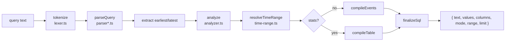
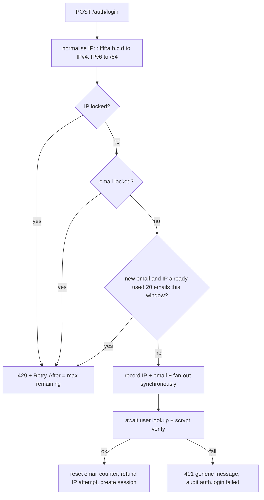
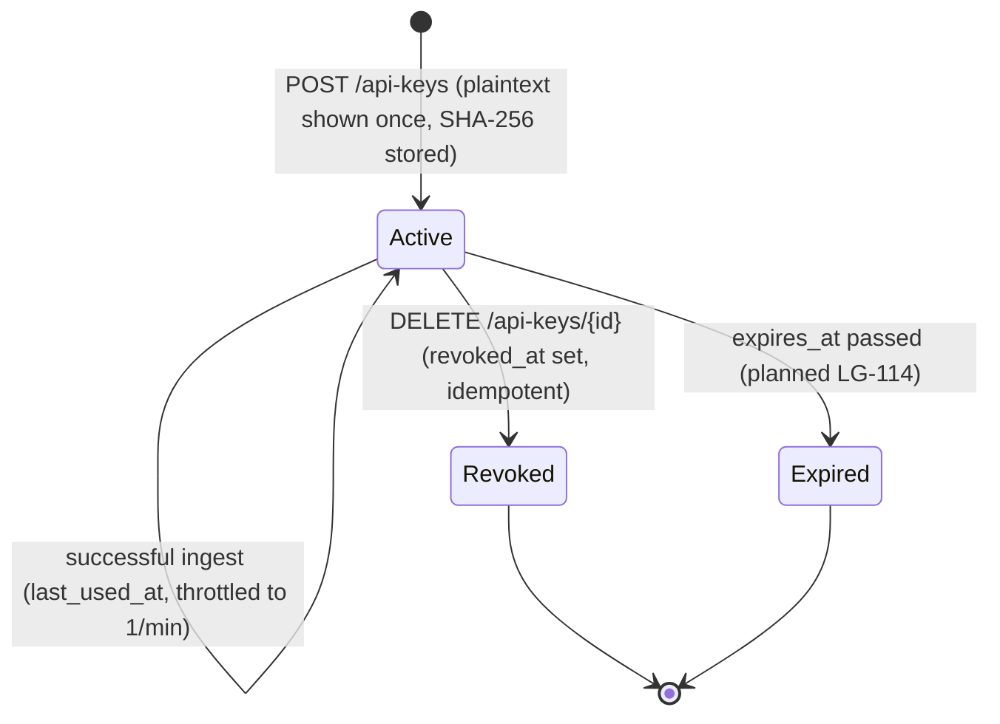
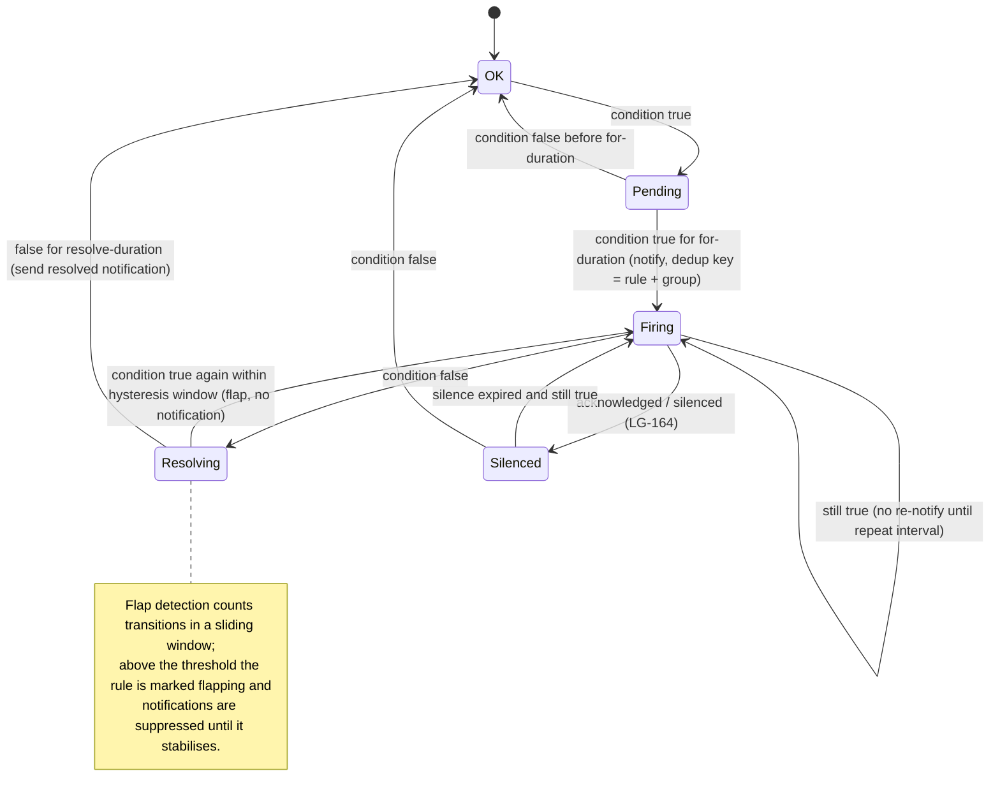
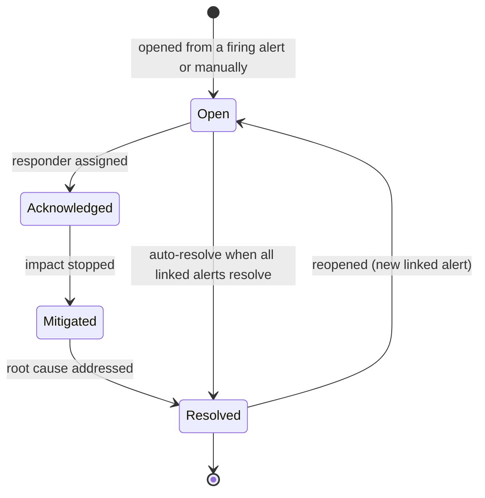
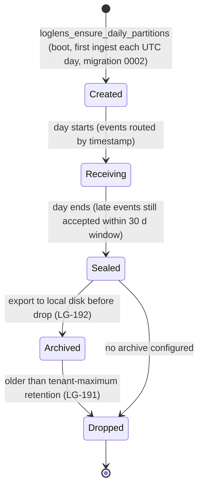
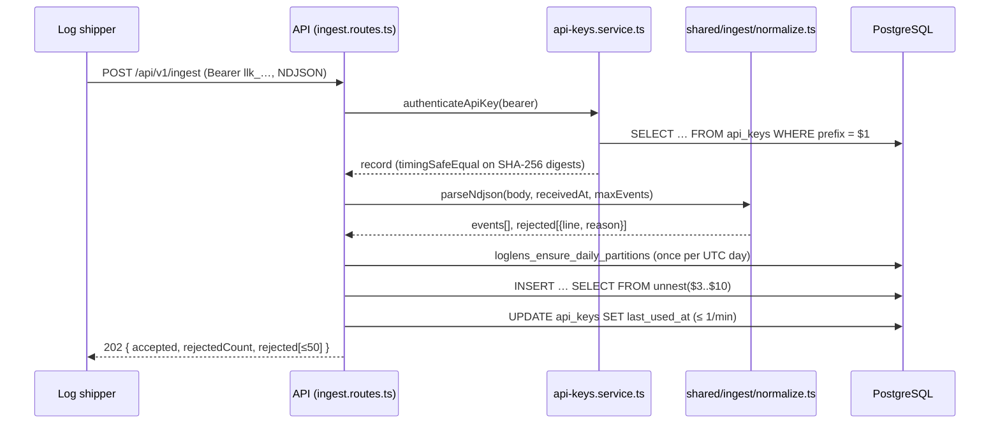
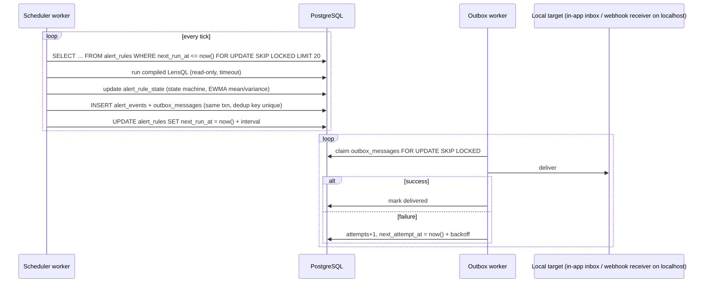

# System Design

This document explains how LogLens works internally: the LensQL language and its compiler, the
ingestion path, the algorithms that matter for correctness and performance, the state machines of
the core entities, and the concurrency strategy. Implemented parts reference real source files;
planned parts name their backlog ticket.

## 1. LensQL

### 1.1 Grammar (EBNF)

Keywords are case-insensitive. Whitespace separates tokens and is otherwise ignored.

```ebnf
query        = [ search ] , { "|" , command } ;
search       = or_expr ;                       (* empty search = match all *)
or_expr      = and_expr , { "OR" , and_expr } ;
and_expr     = not_expr , { [ "AND" ] , not_expr } ;   (* adjacency = implicit AND *)
not_expr     = "NOT" , not_expr | primary ;
primary      = "(" , or_expr , ")"
             | field , cmp_op , value
             | field , regex_op , pattern
             | field , "IN" , "(" , value , { "," , value } , ")"
             | text ;
cmp_op       = "=" | "!=" | ">" | ">=" | "<" | "<=" ;
regex_op     = "=~" | "!~" ;
value        = string | number | bareword ;   (* bareword containing "*" = wildcard; "*" alone = exists *)
pattern      = string | bareword ;
text         = string | number | bareword ;   (* free text over message *)
field        = ident , { "." , segment } ;
ident        = ( letter | "_" ) , { letter | digit | "_" } ;
segment      = ( letter | digit | "_" ) , { letter | digit | "_" | "-" } ;

command      = stats | sort | head | fields | where ;
stats        = "stats" , agg , { "," , agg } , { [ "," ] , ( by_clause | span_clause ) } ;
agg          = agg_fn , [ "(" , [ field ] , ")" ] , [ "as" , alias ] ;
agg_fn       = "count" | "sum" | "avg" | "min" | "max" | "dc" | "p50" | "p90" | "p95" | "p99" ;
by_clause    = "by" , field , { "," , field } ;
span_clause  = "span" , "=" , duration ;      (* 30s, 1m, 5min, 1h, 1d, 1w *)
sort         = "sort" , sort_key , { "," , sort_key } ;
sort_key     = [ "-" ] , name , [ "asc" | "desc" ] ;
head         = "head" , [ integer ] ;          (* default 10, max 10 000 *)
fields       = "fields" , field , { "," , field } ;
where        = "where" , or_expr ;

string       = '"' , { char | "\" , ( '"' | "\" | "n" | "t" ) } , '"' ;
bareword     = word_char , { word_char } ;    (* word_char = [A-Za-z0-9_.\-*:/@] *)
```

Special search fields: `earliest=<time>` and `latest=<time>` are lifted out of the top-level AND
chain into the query time range (`now`, `-15m`, `-2h`, `-7d` or ISO-8601). They are rejected
inside `OR`, `NOT` or `where` because their meaning would be ambiguous
(`packages/shared/src/lensql/parser.ts`).

### 1.2 Front-end pipeline



| Stage    | File                                                            | Responsibility                                                                                     |
| -------- | --------------------------------------------------------------- | -------------------------------------------------------------------------------------------------- |
| Lexer    | `lensql/lexer.ts`                                               | Tokens with character spans; enforces query length, token count, string length, rejects NUL bytes. |
| Parser   | `lensql/parser-expr.ts`, `parser-commands.ts`, `parser-core.ts` | Recursive descent; nesting depth limit; field-name validation; IN/aggregation/projection limits.   |
| Analyzer | `lensql/analyzer.ts`                                            | Splits the pipeline into a pre-aggregation and a post-aggregation stage and enforces ordering.     |
| Compiler | `lensql/compiler.ts`, `compile-expr.ts`, `compile-stats.ts`     | Produces immutable SQL fragments; resolves fields; generates aliases.                              |
| Finalize | `lensql/sql.ts`                                                 | Numbers `$?` placeholders into `$1..$n`.                                                           |

Every failure is a `LensQLError` with `code` (`LEX_ERROR`, `PARSE_ERROR`, `SEMANTIC_ERROR`,
`LIMIT_EXCEEDED`, `TIME_RANGE_ERROR`) and a `span`, which the API returns in
`error.details.span` and the UI underlines (`apps/web/src/pages/search/QueryError.tsx`).

### 1.3 Pipeline stage rules (analyzer)

A query has at most two stages separated by `stats`:

- `head` ends its stage; nothing may follow it in that stage, and `stats` may not follow `head`
  (it would aggregate a truncated sample).
- `where` must precede `sort`; `sort` and `fields` appear at most once per stage.
- `sort`/`fields` before `stats` are rejected because they have no effect.
- After `stats`, `where`, `sort` and `head` refer to output column names (aggregation names,
  `as` aliases, group-by fields and `_time` when `span` is used). Free text is not allowed there.

Pre-stats `where` expressions are AND-ed into the search filter, so `error | where service=api`
and `error service=api` compile to the same predicate.

### 1.4 Compilation walkthrough

Query:

```text
service=checkout http.status>=500 | stats count() as n, p95(latency_ms) by host span=5m | where n>2 | sort -n | head 10
```

Context: tenant `0b9f…0e11`, range `2026-03-10T11:00Z .. 12:00Z`, `maxRows = 10000`.

1. **Lex/parse** produce `and(compare(service = "checkout"), compare(http.status >= 500))` and the
   commands `stats`, `where`, `sort`, `head`.
2. **Analyze**: filters = [search]; stats present; post stage = `where n>2`, `sort -n`, `head 10`.
3. **Resolve fields**: `service` is a column (`e.service`); `http.status` and `latency_ms` are
   attribute paths bound as `text[]` parameters `{http,status}` and `{latency_ms}`.
4. **Bucket budget**: 3600 s / 300 s = 12 buckets per group (limit 10 000).
5. **Emit** (whitespace added for readability):

```sql
SELECT * FROM (
  SELECT date_bin(make_interval(secs => $1::int), e.timestamp, TIMESTAMPTZ '1970-01-01 00:00:00+00') AS g_time,
         e.host AS g0,
         count(*)::float8 AS a0,
         percentile_cont(0.95) WITHIN GROUP (ORDER BY (CASE
            WHEN jsonb_typeof(e.attributes #> $2::text[]) = 'number' THEN (e.attributes #>> $3::text[])::numeric
            WHEN jsonb_typeof(e.attributes #> $4::text[]) = 'string'
             AND (e.attributes #>> $5::text[]) ~ '^-?[0-9]+(\.[0-9]+)?([eE][-+]?[0-9]+)?$'
            THEN (e.attributes #>> $6::text[])::numeric END))::float8 AS a1
    FROM log_events e
   WHERE e.organization_id = $7::uuid
     AND e.timestamp >= $8::timestamptz AND e.timestamp < $9::timestamptz
     AND (COALESCE(e.service = $10, false)
          AND COALESCE((CASE … $11..$15 … END) >= $16::numeric, false))
   GROUP BY g_time, g0
) t
WHERE (COALESCE(t.a0 > $17::float8, false))
ORDER BY t.a0 DESC NULLS LAST
LIMIT $18::int
```

Parameters: `[300, {latency_ms}×5, '0b9f…0e11', '2026-03-10T11:00:00.000Z', '2026-03-10T12:00:00.000Z', 'checkout', {http,status}×5, '500', '2', 10]`.

Properties visible in the output:

- **Only compiler constants appear in SQL text.** Values, attribute paths, intervals and the
  limit are parameters; user aliases (`n`) map to compiler-assigned keys (`a0`) and are returned only as
  column metadata (`columns: [{ key: 'a0', name: 'n', type: 'number' }]`).
- **Tenant and time predicates always lead** the `WHERE` clause and the user filter is
  parenthesised, so a top-level `OR` can never escape tenant scoping, and the planner can prune
  daily partitions.
- **Two-valued logic**: every leaf predicate is `COALESCE(pred, false)`, so `NOT user=ann`
  matches events that have no `user` attribute (ADR-0012).
- **No runtime cast errors**: numeric comparisons on attributes use the `CASE` guard, so a single
  event with `"latency_ms": "n/a"` yields `NULL` instead of failing the whole search.
- **Numbers are bound as strings cast to `numeric`**, preserving arbitrary precision.

The SQL fragment type (`SqlFragment { text, params }`) is immutable; `composeSql('… {} …', a, b)`
concatenates sub-fragments and their parameters in order, and `sql()` asserts at construction that
the number of `$?` markers equals the number of parameters.

### 1.5 Time handling

- Request range defaults to the last hour (`apps/api/src/modules/search/search.service.ts`).
- `earliest`/`latest` override it; the range must satisfy `from < to` and span at most 90 days.
- `timestamp` comparisons inside the search accept the same time expressions and compile to
  `e.timestamp op $n::timestamptz`.
- Buckets align to the Unix epoch both in SQL (`date_bin(..., epoch)`) and in TypeScript
  (`alignToBucket`), so server rows and client-filled gaps line up exactly.

## 2. Algorithms and complexity

| Algorithm               | Location                                    | Time                   | Space         | Notes                                                                                       |
| ----------------------- | ------------------------------------------- | ---------------------- | ------------- | ------------------------------------------------------------------------------------------- |
| Tokenize                | `lensql/lexer.ts`                           | O(n), n = query length | O(tokens)     | Single pass; two-char operators matched before one-char; hard caps 4000 chars / 512 tokens. |
| Parse                   | `lensql/parser-*.ts`                        | O(tokens)              | O(depth)      | LL(2) recursive descent with bounded lookahead (`field IN (` needs 3 tokens); depth ≤ 32.   |
| Time-bound extraction   | `lensql/parser.ts`                          | O(AST nodes)           | O(depth)      | Walks the top-level AND chain only, then asserts no bounds remain deeper.                   |
| Analyze                 | `lensql/analyzer.ts`                        | O(commands)            | O(1)          | Left fold over commands with an immutable stage record.                                     |
| Compile                 | `lensql/compile-*.ts`                       | O(AST nodes)           | O(params)     | Each leaf emits a constant-size fragment; numeric attribute leaves bind the path 5×.        |
| Placeholder numbering   | `lensql/sql.ts` `finalizeSql`               | O(SQL length)          | O(SQL length) | One `replaceAll` pass.                                                                      |
| Histogram width choice  | `lensql/histogram.ts` `chooseBucketSeconds` | O(\|steps\|) = O(18)   | O(1)          | Smallest "nice" width w with range / w ≤ target; falls back to 7 days.                      |
| Dense histogram fill    | `lensql/histogram.ts` `fillHistogram`       | O(buckets + rows)      | O(rows)       | Map rows by aligned bucket start, then emit every bucket in `[from, to)` with 0 defaults.   |
| Event normalisation     | `ingest/normalize.ts`                       | O(size of event)       | O(size)       | Depth check is a bounded recursive walk (stops past depth 8).                               |
| Batch insert            | `modules/ingest/ingest.repo.ts`             | O(batch) server side   | O(batch)      | One statement: ten array parameters expanded by `unnest`.                                   |
| Limiter check / record  | `modules/auth/attempt-limiter.ts`           | O(1) amortised         | O(keys)       | Map lookups; lock = `min(lockMs · 2^(count−threshold), maxLockMs)`.                         |
| Bounded store make-room | `modules/auth/bounded-store.ts`             | O(n) worst case        | O(1) extra    | See below.                                                                                  |

### 2.1 Bounded limiter store

The in-process limiter maps (`login:email`, `login:ip`, `login:fanout`, `register:ip`) are capped
(default 50 000 entries each). When inserting a **new** key into a full map:

1. **Resumable sweep**: a persistent `Map` key iterator continues where the previous sweep
   stopped, wrapping around at the end. It scans at most `size` entries, deleting those whose
   `expiresAt ≤ now`, and stops as soon as there is room. Because the cursor persists, repeated
   sweeps cover the whole map instead of re-examining the oldest keys forever.
2. **Evict least-remaining**: if every entry is still active, one O(n) pass finds the entry with
   the smallest `expiresAt`, deletes it and logs a warning with the remaining time.

The store never refuses a key, so an attacker who fills it cannot lock out legitimate users; the
worst case is that the oldest lockout expires early, which is logged. Updating an existing key
never triggers eviction. Multi-instance deployments need shared counters (LG-216, ADR-0008).

### 2.2 Login throttle decision



Steps up to `record` are synchronous, so N parallel requests are all counted before any password
check runs; at most 5 of them reach scrypt for one email in a window.

## 3. State machines

### 3.1 Session (implemented)

```mermaid
stateDiagram-v2
  [*] --> Active: login (token hash stored, expires_at = now + SESSION_TTL_HOURS)
  Active --> Active: authenticated request (last_seen_at touched at most once per minute)
  Active --> Ended: logout (row deleted, cookie cleared)
  Active --> Expired: now > expires_at
  Expired --> [*]: ignored by findSession; purge job planned (LG-213)
  Ended --> [*]
```

### 3.2 Ingestion API key (implemented)



### 3.3 Alert rule instance (planned, LG-163/LG-166)



### 3.4 Incident (planned, LG-180)



Every transition appends an `incident_events` row, which is the incident timeline (LG-181).

### 3.5 Daily partition (implemented creation, planned retention)



Rows outside every daily partition land in `log_events_default`. Ingestion only accepts events no
older than 30 days and no more than 10 minutes in the future (later events are clamped and flagged
`_clock_skew`), and partitions are created 31 days back and 7 days ahead, so the default partition
stays empty in normal operation (asserted by `apps/api/test/migrate.db.test.ts`). Draining it is
part of LG-191.

## 4. Sequence diagrams

### 4.1 Ingest (implemented)



### 4.2 Search (implemented)

```mermaid
sequenceDiagram
  participant U as Browser
  participant A as API (search.routes.ts)
  participant C as shared/lensql compiler
  participant P as PostgreSQL
  U->>A: POST /api/v1/search {query, from, to} + cookie + x-csrf-token
  A->>A: CSRF check, session lookup, permission search:read
  A->>C: compileQuery(query, {organizationId, range, now, limits})
  alt invalid
    C-->>A: LensQLError(span)
    A-->>U: 422 QUERY_INVALID {span}
  else valid
    C-->>A: {text, values, columns, mode}
    A->>P: BEGIN READ ONLY; set_config('statement_timeout', 5000, true)
    A->>P: compiled statement
    P-->>A: rows (or 57014 timeout)
    A->>P: COMMIT
    A-->>U: 200 {mode, columns, rows, stats}
  end
```

The UI issues the search and histogram requests in parallel (`SearchPage.tsx`).

### 4.3 Live tail (planned, LG-140, ADR-0018)

```mermaid
sequenceDiagram
  participant U as Browser
  participant W as Tail hub (API process)
  participant I as Ingest handler
  participant P as PostgreSQL
  U->>W: GET /api/v1/tail (WebSocket upgrade, query)
  W->>W: compile filter once to an in-memory predicate
  W->>P: LISTEN log_events_<org>
  I->>P: INSERT batch; NOTIFY log_events_<org>, '{minId, maxId}'
  P-->>W: notification
  W->>P: SELECT … WHERE id BETWEEN minId AND maxId AND org = $1
  W-->>U: matching events (rate-limited, dropped-count frames on overflow)
```

### 4.4 Alert evaluation and outbox delivery (planned, LG-161/LG-171, ADR-0017/0019)



EWMA anomaly rules keep `μ_t = α·x_t + (1−α)·μ_{t−1}` and
`σ²_t = (1−α)·(σ²_{t−1} + α·(x_t − μ_{t−1})²)`, firing when `|x_t − μ_{t−1}| > k·σ_{t−1}` after a
warm-up of N intervals; state is O(1) per rule and group.

## 5. Concurrency and consistency

| Concern                         | Strategy                                                                                                                                                                                                                                                                                                                                        | Where                                  |
| ------------------------------- | ----------------------------------------------------------------------------------------------------------------------------------------------------------------------------------------------------------------------------------------------------------------------------------------------------------------------------------------------- | -------------------------------------- |
| Parallel login attempts         | Limiter `check` + `record` run synchronously before the first `await`; success resets the email counter and refunds the IP slot.                                                                                                                                                                                                                | `auth.service.ts`, `login-throttle.ts` |
| Concurrent migrations           | `pg_advisory_lock(hashtext('loglens:migrate'))` around the runner; each file in its own transaction; checksums detect edits.                                                                                                                                                                                                                    | `db/migrate.ts`                        |
| Duplicate registration race     | `pg_advisory_xact_lock(hashtext('register:<email>'))` inside the transaction plus the unique index on `lower(email)`.                                                                                                                                                                                                                           | `auth.service.ts`, migration 0001      |
| Partition creation              | `loglens_ensure_daily_partitions` checks `to_regclass` and is idempotent; called at boot and memoised once per UTC day per process. Two processes racing on the same day can collide on `CREATE TABLE`; the loser's ingest request fails once and succeeds on retry. A dedicated partition manager (LG-191) removes this from the request path. | migration 0002, `db/partitions.ts`     |
| Batch atomicity                 | One `INSERT … SELECT FROM unnest` statement: a batch is fully stored or not at all.                                                                                                                                                                                                                                                             | `ingest.repo.ts`                       |
| Search isolation                | `BEGIN READ ONLY` + transaction-local `statement_timeout`; the connection is returned clean after `COMMIT`/`ROLLBACK`.                                                                                                                                                                                                                          | `search.service.ts`                    |
| Audit integrity                 | Trigger rejects `UPDATE`/`DELETE` on `audit_events`.                                                                                                                                                                                                                                                                                            | migration 0001                         |
| Alert scheduling (planned)      | Rules leased with `FOR UPDATE SKIP LOCKED`; `next_run_at` advanced in the same transaction, so each due rule is evaluated by exactly one worker.                                                                                                                                                                                                | LG-161                                 |
| Notification delivery (planned) | Transactional outbox: alert state and outbox row commit together; at-least-once delivery with a unique dedup key per message.                                                                                                                                                                                                                   | LG-171                                 |
| Limiter state across instances  | In-process today (single API instance supported). Moving counters to Postgres with `INSERT … ON CONFLICT DO UPDATE` is LG-216.                                                                                                                                                                                                                  | ADR-0008                               |
