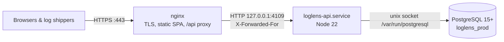

# Deployment

LogLens runs on a plain Linux VM or bare-metal host. The layout is native PostgreSQL, one Node.js API process managed by systemd, and nginx for TLS, the static SPA and the reverse proxy. Nothing runs in containers and nothing calls out to the internet at runtime.



## 1. Single-instance constraint

Run **exactly one API process** per database until **LG-216** moves login and registration throttle counters into PostgreSQL. The counters are in-process today ([threat-model.md §5](../security/threat-model.md#5-limiter-state-is-in-process)). With two instances an attacker gets twice the login budget, and lockouts on one instance do not apply on the other. Scale vertically (CPU, RAM, PostgreSQL tuning) until then.

## 2. Host preparation (Debian/Ubuntu example)

```bash
sudo apt install -y postgresql postgresql-contrib nginx
# Node.js 22+ from your distribution or the official Node.js binary tarball
sudo useradd --system --home /opt/loglens --shell /usr/sbin/nologin loglens
sudo -u postgres createuser loglens
sudo -u postgres createdb -O loglens loglens_prod
sudo -u postgres psql -d loglens_prod -c 'CREATE EXTENSION IF NOT EXISTS pg_trgm; CREATE EXTENSION IF NOT EXISTS pgcrypto;'
```

The `loglens` role needs no superuser rights. It owns the database, which is enough for migrations because both extensions are created up front by the `postgres` user.

## 3. Configuration

`/etc/loglens/loglens.env` (mode `0640`, owner `root:loglens`):

```ini
NODE_ENV=production
API_HOST=127.0.0.1
API_PORT=4109
WEB_ORIGIN=https://logs.example.internal
LOG_LEVEL=info
DATABASE_URL=postgresql:///loglens_prod?host=/var/run/postgresql
SESSION_SECRET=<64 hex chars from: openssl rand -hex 32>
SESSION_TTL_HOURS=12
# nginx on the same host overwrites X-Forwarded-For => trust exactly one hop
TRUST_PROXY=1
QUERY_TIMEOUT_MS=5000
QUERY_MAX_ROWS=10000
INGEST_MAX_BODY_BYTES=5242880
INGEST_MAX_EVENTS_PER_REQUEST=5000
```

`TRUST_PROXY` is mandatory in production. The API refuses to start without it. It must match the topology: one local nginx means `1`. If the API is exposed without a proxy, use `false`.

## 4. Build and install a release

On a build machine (or the host itself):

```bash
git clone https://github.com/mayur19/loglens.git && cd loglens
git checkout v0.1.0
npm ci
npm run build          # apps/api/dist (bundled, includes @loglens/shared) and apps/web/dist
```

Install into a versioned directory:

```bash
REL=/opt/loglens/releases/0.1.0
sudo mkdir -p $REL
sudo cp -r package.json package-lock.json apps packages $REL/
cd $REL && sudo npm ci --omit=dev
sudo -u loglens node --env-file=/etc/loglens/loglens.env $REL/apps/api/dist/db/cli.js migrate
sudo ln -sfn $REL /opt/loglens/current
```

## 5. systemd unit

`/etc/systemd/system/loglens-api.service`:

```ini
[Unit]
Description=LogLens API
After=network.target postgresql.service
Requires=postgresql.service

[Service]
Type=simple
User=loglens
Group=loglens
WorkingDirectory=/opt/loglens/current/apps/api
EnvironmentFile=/etc/loglens/loglens.env
ExecStart=/usr/bin/node dist/index.js
Restart=on-failure
RestartSec=3
# hardening
NoNewPrivileges=true
ProtectSystem=strict
ProtectHome=true
PrivateTmp=true
ReadWritePaths=/var/log/loglens
LimitNOFILE=65536

[Install]
WantedBy=multi-user.target
```

```bash
sudo systemctl daemon-reload
sudo systemctl enable --now loglens-api
curl -fsS http://127.0.0.1:4109/ready
```

Logs go to journald as JSON lines: `journalctl -u loglens-api -o cat | jq`.

## 6. nginx

`/etc/nginx/sites-available/loglens`:

```nginx
server {
    listen 443 ssl http2;
    server_name logs.example.internal;

    ssl_certificate     /etc/ssl/loglens/fullchain.pem;
    ssl_certificate_key /etc/ssl/loglens/privkey.pem;

    root /opt/loglens/current/apps/web/dist;
    index index.html;

    # Ingest batches can be large; keep in line with INGEST_MAX_BODY_BYTES.
    client_max_body_size 6m;

    location /api/ {
        proxy_pass http://127.0.0.1:4109;
        proxy_http_version 1.1;
        proxy_set_header Host $host;
        # Overwrite (do not append) so clients cannot inject their own hops; matches TRUST_PROXY=1.
        proxy_set_header X-Forwarded-For $remote_addr;
        proxy_set_header X-Forwarded-Proto $scheme;
        proxy_set_header X-Request-Id $request_id;
        proxy_read_timeout 30s;
    }

    location = /health { proxy_pass http://127.0.0.1:4109; }
    location = /ready  { proxy_pass http://127.0.0.1:4109; allow 127.0.0.1; deny all; }

    location /assets/ {
        expires 1y;
        add_header Cache-Control "public, immutable";
    }

    # SPA routes
    location / {
        try_files $uri /index.html;
    }
}

server {
    listen 80;
    server_name logs.example.internal;
    return 301 https://$host$request_uri;
}
```

The live-tail WebSocket (LG-140) will need `proxy_set_header Upgrade $http_upgrade; proxy_set_header Connection "upgrade";` on `/api/v1/tail`.

## 7. Release procedure

1. Read `CHANGELOG.md` for migration notes.
2. Back up first: `pg_dump -Fc` ([runbook §3](runbook.md#3-backup-and-restore)).
3. Build and install into `/opt/loglens/releases/<version>` (§4). Do not touch `current` yet.
4. Run migrations from the new release. Migrations are forward-only and must stay compatible with the previous release's code for one version (additive columns and tables only; drops happen one release later).
5. `sudo ln -sfn /opt/loglens/releases/<version> /opt/loglens/current && sudo systemctl restart loglens-api`.
6. Check: `curl -fsS https://logs.example.internal/ready`, sign in, run a search, ingest a test event with a canary key.

## 8. Rollback

- **Code only** (no new migration in the release): point `current` at the previous release and `systemctl restart loglens-api`.
- **With migrations:** because migrations are additive for one release, the previous code runs against the newer schema, so roll back the symlink as above. Only if a migration corrupted data, restore the pre-release dump ([runbook §3](runbook.md#3-backup-and-restore)). Events ingested after the backup are lost unless the shippers buffer and replay.

## 9. Scheduled jobs (until LG-191 automates them)

```cron
# nightly backup at 02:15 UTC
15 2 * * * loglens pg_dump -h /var/run/postgresql -d loglens_prod -Fc -f /var/backups/loglens/loglens-$(date -u +\%Y\%m\%d).dump
# pre-create partitions daily (the API also does this on boot and on first ingest per day)
5 0 * * * loglens psql -h /var/run/postgresql -d loglens_prod -c "SELECT loglens_ensure_daily_partitions(current_date, current_date + 7)"
```
