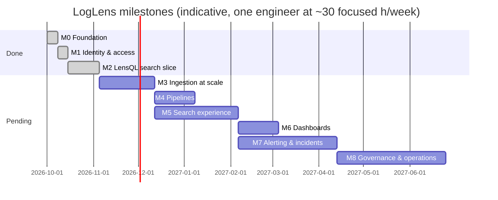

# Roadmap

Milestones are ordered by dependency. Hours come from [backlog.md](backlog.md). M0–M2 make up the foundation and the first vertical slice (LensQL search over ingested events) and are complete.

| Milestone                              | Goal                                                                                      | Tickets                         | Hours (done / total) | Status  |
| -------------------------------------- | ----------------------------------------------------------------------------------------- | ------------------------------- | -------------------- | ------- |
| M0 Foundation                          | Monorepo, config, app shell, migrations, run.sh, CI                                       | LG-001 – LG-008                 | 32 / 32              | Done    |
| M1 Identity & access                   | Register, sessions, CSRF, throttling, RBAC, audit                                         | LG-010 – LG-015                 | 29 / 29              | Done    |
| M2 LensQL search slice                 | Lexer → parser → analyzer → SQL compiler, partitioned store, API-key ingestion, search UI | LG-020 – LG-034                 | 88 / 88              | Done    |
| M3 Ingestion at scale                  | Backpressure, COPY writer, syslog, quotas, per-key limits                                 | LG-100 – LG-114                 | 0 / 158              | Pending |
| M4 Pipelines                           | Grok-style field extraction at ingest                                                     | LG-120 – LG-125                 | 0 / 114              | Pending |
| M5 Search experience & live tail       | Saved searches, rex/eval/timechart, autocomplete, field catalog, export, live tail        | LG-130 – LG-142 (except LG-138) | 0 / 240              | Pending |
| M6 Dashboards                          | SVG time-series panels, variables, caching                                                | LG-150 – LG-154, LG-138         | 0 / 114              | Pending |
| M7 Alerting, notifications & incidents | Leased scheduler, threshold/EWMA rules, flapping suppression, outbox, incidents           | LG-160 – LG-182                 | 0 / 282              | Pending |
| M8 Governance & operations             | Retention, partition manager, members/invites, MFA, Postgres-backed limiters, ops tooling | LG-190 – LG-225                 | 0 / 314              | Pending |

## Exit criteria

### M0 Foundation — done

- `npm run lint && npm run format:check && npm run typecheck && npm test && npm run build` green locally and in CI with native PostgreSQL.
- `./run.sh setup` works on a fresh clone against a local socket database.
- `/health` and `/ready` respond. Errors use the JSON envelope with request IDs.

### M1 Identity & access — done

- Register, login, logout and `/me` covered by integration tests.
- CSRF required on every mutating browser request.
- Parallel bad logins cannot exceed the email threshold. IP spraying and fan-out are capped.
- Registration does not reveal whether an email exists.

### M2 LensQL search slice — done

- LensQL grammar (filters, boolean logic, regex, IN, existence, time bounds, stats/sort/head/fields/where) parses with precise error spans.
- Compiled SQL contains no user text. The injection suite and executed payloads pass. Every statement is tenant- and time-scoped.
- NDJSON/JSON ingestion with API keys writes into daily partitions.
- The Search UI shows the histogram, results and error underline. Demo seed available.

### M3 Ingestion at scale

- Sustained ≥ 5 000 events/s per instance on the reference VM (NFR-002) with p95 ack < 250 ms for 1 000-event batches (NFR-003), measured by LG-102.
- Full queue → `429` with `Retry-After`. No unbounded memory growth under overload.
- RFC 5424 and RFC 3164 syslog accepted, with conformance fixtures.
- Per-tenant daily quotas enforced and reported (`GET /api/v1/ingest/quota`).

### M4 Pipelines

- Pattern engine handles the shipped library (nginx, apache, syslog, JSON-in-message) with typed captures.
- Per-event budget prevents pathological patterns from stalling ingestion.
- Dry-run endpoint and editor preview match ingest-time behaviour byte for byte.

### M5 Search experience & live tail

- Saved searches can be shared within an organization.
- `rex`, `eval`, `timechart`, `top` and `rare` compile to parameterised SQL with the same injection guarantees (extended suite).
- Live tail delivers matching events in < 2 s end to end (NFR-019) to 50 concurrent viewers per instance.
- Autocomplete suggests fields from the catalog with sampled types.

### M6 Dashboards

- Panels render with the in-house SVG chart library. Dashboard variables flow into queries as parameters.
- Repeated panel queries are served from cache within the refresh interval.

### M7 Alerting, notifications & incidents

- No missed or duplicate evaluations across scheduler restarts (simulated-clock suite, LG-167).
- Alerts fire within two evaluation intervals (NFR-018). Flapping rules are suppressed by hysteresis.
- EWMA anomaly rules backtest against history before saving.
- Webhooks and emails are written to the local outbox and delivered with retries. No external providers.
- Incident timelines show alert transitions, notes and linked searches.

### M8 Governance & operations

- Retention drops expired partitions within 1 h of the boundary (NFR-017), with optional local archive.
- Limiter counters live in PostgreSQL, so multiple API instances are supported (LG-216).
- Members, invitations, password reset, email verification and TOTP MFA are complete.
- Backup/restore drill and load-test report are automated. systemd/nginx scripts are versioned.
