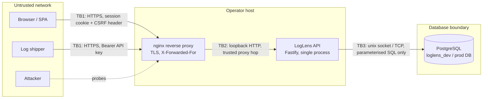

# Threat Model

Scope: LogLens 0.1.0 as built in this repository: the Fastify API (`apps/api`), the React SPA (`apps/web`), the LensQL front end and compiler (`packages/shared/src/lensql`) and the PostgreSQL database. This document covers what is implemented today. Where a mitigation is still planned, it names the backlog ticket.

## 1. System description

LogLens takes log events over HTTP from log shippers that authenticate with API keys. It stores them in a time-partitioned PostgreSQL table, and lets signed-in users of each organization search them with LensQL. LensQL is a query language compiled to one parameterised SQL statement per request. Browser users authenticate with a session cookie. Machine clients (shippers) authenticate with a bearer API key and only reach `POST /api/v1/ingest`.

## 2. Assets

| Asset                             | Why it matters                                                                        | Where it lives                                             |
| --------------------------------- | ------------------------------------------------------------------------------------- | ---------------------------------------------------------- |
| Log events                        | Can hold customer identifiers, IPs, stack traces, sometimes secrets logged by mistake | `log_events` partitions                                    |
| Credentials                       | Account takeover                                                                      | `users.password_hash` (scrypt)                             |
| Session tokens                    | Impersonation                                                                         | Cookie `ll_session`; only SHA-256 in `sessions.token_hash` |
| Ingestion API keys                | Lets an attacker write forged events into a tenant                                    | Plaintext shown once; SHA-256 in `api_keys.key_hash`       |
| Tenant boundary                   | One customer must never read another's logs                                           | `organization_id` on every row and query                   |
| Audit trail                       | Forensics and accountability                                                          | `audit_events` (append-only trigger)                       |
| Availability of search and ingest | Operators rely on logs during incidents                                               | API process, PostgreSQL                                    |

## 3. Trust boundaries

- **TB1, internet to edge:** everything that crosses it is untrusted. This covers bodies, headers, cookies, LensQL text and NDJSON lines.
- **TB2, proxy to API:** `X-Forwarded-For` is honoured only as far as `TRUST_PROXY` allows (see §6).
- **TB3, API to database:** the API is the only client. All user data reaches SQL as bound parameters.

## 4. STRIDE analysis

### 4.1 Browser / SPA

| Threat                 | Example                                                | Mitigation (implemented)                                                                                                                                                   | Reference                                                         |
| ---------------------- | ------------------------------------------------------ | -------------------------------------------------------------------------------------------------------------------------------------------------------------------------- | ----------------------------------------------------------------- |
| Spoofing               | A stolen session cookie is replayed                    | Cookie is HttpOnly and SameSite=Lax, with `Secure` in production. The token has 256 bits of entropy and only its hash is stored. Sessions expire after `SESSION_TTL_HOURS` | `apps/api/src/http/cookies.ts`, `modules/auth/auth.service.ts`    |
| Tampering              | Cross-site form posts a search or revokes a key        | Double-submit CSRF check: cookie `ll_csrf` must equal header `x-csrf-token`, compared in constant time, on every non-GET `/api/*` request                                  | `apps/api/src/http/csrf.ts`                                       |
| Repudiation            | A user denies revoking a key                           | `api_key.create`, `api_key.revoke`, `auth.login`, `auth.login.failed`, `auth.logout`, `auth.register` are written to the append-only audit trail                           | `modules/audit/audit.repo.ts`, migration `0001`                   |
| Information disclosure | Log content with HTML is rendered in the results table | React escapes all text nodes and attributes are shown as JSON text. No `dangerouslySetInnerHTML` anywhere                                                                  | `apps/web/src/pages/search/ResultsTable.tsx`                      |
| Denial of service      | User triggers huge queries repeatedly                  | Server-side guard rails (§4.4). Per-user query rate limits are planned                                                                                                     | LG-137                                                            |
| Elevation of privilege | A viewer calls key-management endpoints directly       | RBAC is checked server-side by `requireAuth(db, permission)`. The UI hides controls only for convenience                                                                   | `apps/api/src/http/auth-guard.ts`, `packages/shared/src/roles.ts` |

### 4.2 API (session-authenticated routes)

| Threat                 | Example                                     | Mitigation                                                                                                                                                                           | Reference                                                |
| ---------------------- | ------------------------------------------- | ------------------------------------------------------------------------------------------------------------------------------------------------------------------------------------ | -------------------------------------------------------- |
| Spoofing               | Credential stuffing or password spraying    | Login throttle with three counters: per-email progressive backoff, per-IP spray lock, and a cap on distinct emails per IP. Attempts are reserved synchronously before any `await`    | `modules/auth/login-throttle.ts`, `attempt-limiter.ts`   |
| Spoofing               | Probing to learn which emails have accounts | Login gives the same 401 message for unknown users and wrong passwords. A dummy scrypt hash equalises timing. Registration returns the same 202 body whether or not the email exists | `auth.service.ts`, `crypto.ts#getDummyHash`              |
| Tampering              | Mass assignment through extra JSON fields   | Zod schemas validate at every boundary. Search and key schemas are `.strict()`                                                                                                       | `packages/shared/src/schemas/*`, `http/validate.ts`      |
| Repudiation            | Requests cannot be correlated               | Every response carries `x-request-id`, which is also logged and stored in audit rows                                                                                                 | `apps/api/src/app.ts`                                    |
| Information disclosure | Stack traces leak in errors                 | The central handler returns `INTERNAL` with a generic message and logs details server-side only. Pino redacts cookies, authorization and CSRF headers                                | `http/error-handler.ts`, `app.ts`                        |
| Denial of service      | Very large JSON bodies                      | Global `bodyLimit` of 1 MiB, with a separate ingest limit (§4.3)                                                                                                                     | `app.ts`                                                 |
| Elevation of privilege | Cross-tenant access by guessing UUIDs       | Every repository query filters by the session's `organization_id`. The tenant comes from the session, never from the request body                                                    | `modules/api-keys/api-keys.repo.ts`, `search.service.ts` |

### 4.3 Ingestion endpoint (`POST /api/v1/ingest`)

| Threat                 | Example                                                 | Mitigation                                                                                                                                                                                                                                      | Reference                                 |
| ---------------------- | ------------------------------------------------------- | ----------------------------------------------------------------------------------------------------------------------------------------------------------------------------------------------------------------------------------------------- | ----------------------------------------- |
| Spoofing               | Guessed or forged API key                               | Keys have 256 bits of entropy. Lookup is by the public 8-character prefix, then `timingSafeEqual` on SHA-256 digests. A dummy digest is compared when the prefix is unknown, so timing does not reveal valid prefixes. Revoked keys are refused | `modules/api-keys/api-keys.service.ts`    |
| Tampering              | Events with forged timestamps far in the future or past | Future skew above 10 min is clamped to receive time and flagged `_clock_skew`. Events older than 30 days are rejected per line                                                                                                                  | `packages/shared/src/ingest/normalize.ts` |
| Tampering              | Shipper submits events for another tenant               | The tenant is taken from the key record. Body fields cannot choose `organization_id`                                                                                                                                                            | `ingest.routes.ts`, `ingest.repo.ts`      |
| Information disclosure | Key leaked in logs                                      | The `authorization` header is redacted. Only the prefix is shown in the UI                                                                                                                                                                      | `app.ts`, `ApiKeysPage.tsx`               |
| Denial of service      | Huge or deeply nested payloads                          | Body size is capped by `INGEST_MAX_BODY_BYTES`, events per request by `INGEST_MAX_EVENTS_PER_REQUEST`, messages at 32 KiB (truncated and flagged), attributes at 16 KiB and depth 8. Backpressure and quotas are planned                        | LG-100, LG-112, LG-113                    |
| Denial of service      | Decompression bombs                                     | Compressed bodies are not accepted yet. When added, the decompressed size will be bounded                                                                                                                                                       | LG-103                                    |
| Elevation of privilege | Using an ingest key on the search API                   | Session-only routes never accept bearer keys. Key scopes are planned                                                                                                                                                                            | LG-114                                    |

### 4.4 LensQL front end and compiler

| Threat                    | Example                                                   | Mitigation                                                                                                                                                                                                                                                                                                                    | Reference                                                                               |
| ------------------------- | --------------------------------------------------------- | ----------------------------------------------------------------------------------------------------------------------------------------------------------------------------------------------------------------------------------------------------------------------------------------------------------------------------- | --------------------------------------------------------------------------------------- |
| Tampering (SQL injection) | `message="x' OR '1'='1"`, `"; DROP TABLE log_events; --"` | Fragments contain only compiler constants plus `$?` placeholders, which are numbered at the end. Values, attribute paths (as `text[]`), regexes, numbers and time bounds are all bound parameters. Field names must match a strict regex. Aliases map to compiler-assigned keys (`a0`, `g0`, `f0`) and are never interpolated | `lensql/sql.ts`, `compile-expr.ts`, `compile-stats.ts`, `test/lensql/injection.test.ts` |
| Information disclosure    | Top-level `OR` escaping the tenant predicate              | The tenant and time predicate is emitted first and joined with `AND` to a parenthesised filter. Compilation rejects a non-UUID tenant                                                                                                                                                                                         | `compiler.ts#basePredicate`                                                             |
| Denial of service         | Pathological regex, huge ranges, thousands of buckets     | Query ≤ 4000 chars, ≤ 512 tokens, nesting ≤ 32, regex ≤ 256 chars, range ≤ 90 days, stats buckets ≤ 10 000, row cap `QUERY_MAX_ROWS`. Execution runs in `BEGIN READ ONLY` with a local `statement_timeout` (`QUERY_TIMEOUT_MS`)                                                                                               | `lensql/limits.ts`, `search.service.ts`                                                 |
| Tampering                 | Query writes data                                         | The transaction is read-only, so any write fails at the database                                                                                                                                                                                                                                                              | `search.service.ts#runReadOnly`                                                         |
| Repudiation               | Expensive queries cannot be traced                        | Request IDs are logged. A query audit log is planned                                                                                                                                                                                                                                                                          | LG-137                                                                                  |

### 4.5 PostgreSQL

| Threat                         | Mitigation                                                                                                                                                                            |
| ------------------------------ | ------------------------------------------------------------------------------------------------------------------------------------------------------------------------------------- |
| Spoofing                       | Local deployments connect over the unix socket with peer authentication. Production uses a dedicated role with no superuser rights (see [deployment.md](../operations/deployment.md)) |
| Tampering with the audit trail | A `BEFORE UPDATE OR DELETE` trigger raises an error on `audit_events`                                                                                                                 |
| Information disclosure         | Credentials, session tokens and API keys are stored only as hashes. Backups (`pg_dump -Fc`) must be encrypted at rest by the operator                                                 |
| Denial of service              | Statement timeout on searches. Partition pruning through the leading time predicate. Rows routed to `log_events_default` are monitored (runbook)                                      |
| Elevation of privilege         | Row-level security as a second layer is planned (LG-204)                                                                                                                              |

### 4.6 Operator host

| Threat                        | Mitigation                                                                          |
| ----------------------------- | ----------------------------------------------------------------------------------- |
| Secrets in the repo           | `.env` is git-ignored. `run.sh setup` creates `SESSION_SECRET` from 32 random bytes |
| Misconfigured proxy trust     | Startup fails in production when `TRUST_PROXY` is unset (§6)                        |
| Running a second API instance | Not supported until LG-216. Limiter state is per process (§5)                       |
| Reset in production           | `run.sh reset` and `db/cli.ts reset` refuse when `NODE_ENV=production`              |

## 5. Limiter state is in-process

The login throttle, the distinct-email cap and the registration limiter keep their counters in memory. Each `BoundedStore` holds at most 50 000 entries per limiter. When full, it sweeps expired entries with a resumable cursor. If every entry is still active, it evicts the one with the least time left and logs a warning. It never refuses new keys, so filling the store cannot lock out unrelated users.

**These counters must move to PostgreSQL (LG-216) before LogLens runs more than one API instance.** With N instances behind a load balancer, an attacker gets N times the budget, and a restart clears every lockout. Until then, deployment is single-instance only ([deployment.md](../operations/deployment.md)).

## 6. TRUST_PROXY guidance

`request.ip` feeds every IP-keyed limiter, so getting it wrong either disables spray protection (every request appears to come from the proxy) or lets clients choose their own IP (spoofed `X-Forwarded-For`).

| Topology                                                     | Setting                                          |
| ------------------------------------------------------------ | ------------------------------------------------ |
| API reachable directly, no proxy                             | `TRUST_PROXY=false` (default outside production) |
| One nginx on the same host that overwrites `X-Forwarded-For` | `TRUST_PROXY=1`                                  |
| Known proxy addresses                                        | `TRUST_PROXY=127.0.0.1,10.0.0.0/8`               |

The value is never derived from `NODE_ENV`. In production the process refuses to start without an explicit value (`apps/api/src/config/env.ts`). Client IPs are normalised before they are used as limiter keys. IPv4-mapped IPv6 becomes IPv4, and other IPv6 addresses collapse to their /64 (`modules/auth/ip.ts`).

## 7. Registration non-enumeration

`POST /api/v1/auth/register` always answers `202` with the same message. It never signs the caller in, so the response cannot reveal whether the account was created or already existed. A duplicate still pays the scrypt cost, takes a per-email advisory lock and writes an `auth.register.duplicate` audit row. Registration is limited to 5 per normalised IP per hour. Email verification through the local outbox (LG-211) will replace the "sign in to continue" step.

## 8. Residual risks

| Risk                                  | Status                                                                                 |
| ------------------------------------- | -------------------------------------------------------------------------------------- |
| Limiter bypass with several instances | Accepted until LG-216; single instance is enforced by procedure                        |
| Sensitive data inside logged messages | Operators must scrub at the source. Pipeline redaction processors are planned (LG-124) |
| Regex cost within the timeout         | Bounded by `statement_timeout`. A cost guard is planned (LG-137)                       |
| No MFA                                | Planned (LG-212)                                                                       |
| No CSP header yet                     | Planned (LG-217)                                                                       |
| Ingest flood within body limits       | Quotas and backpressure are planned (LG-100, LG-112, LG-113)                           |

## 9. OWASP ASVS 4.0 mapping

| Chapter                               | Requirement area                                                       | LogLens implementation                                                                                                       | Gap / ticket                                    |
| ------------------------------------- | ---------------------------------------------------------------------- | ---------------------------------------------------------------------------------------------------------------------------- | ----------------------------------------------- |
| V2 Authentication                     | 2.1 password length ≥ 12, 2.2 anti-automation, 2.4 credential storage  | `passwordSchema` min 12 / max 256. Email backoff + IP spray limiter + fan-out cap. scrypt N=16384 r=8 p=1 with per-hash salt | MFA LG-212; breached-password check not planned |
| V3 Session management                 | 3.2 token entropy, 3.3 logout/expiry, 3.4 cookie attributes            | 256-bit tokens, hashed at rest, TTL, server-side delete on logout. HttpOnly, SameSite=Lax, Secure in production              | Session list/revoke LG-213                      |
| V4 Access control                     | 4.1 server-side enforcement, 4.2 IDOR                                  | `requireAuth(db, permission)`. Every query scoped by session `organization_id`                                               | Custom roles LG-203; RLS LG-204                 |
| V5 Validation, sanitisation, encoding | 5.1 input validation, 5.3 output encoding, 5.3.4 parameterised queries | Zod at every boundary. LensQL compiled with bound parameters only. React output encoding                                     | —                                               |
| V7 Error handling and logging         | 7.1 no sensitive data in logs, 7.3 log integrity                       | Pino redaction, generic 500s, request IDs, append-only audit trigger                                                         | Audit browser LG-205                            |
| V8 Data protection                    | 8.3 sensitive data at rest                                             | Secrets hashed. `Cache-Control: no-store` on API responses                                                                   | Archive encryption guidance in LG-192           |
| V9 Communications                     | 9.1 TLS                                                                | TLS terminates at nginx ([deployment.md](../operations/deployment.md))                                                       | —                                               |
| V13 API and web services              | 13.2 RESTful security, CSRF, content types                             | Double-submit CSRF. Ingest accepts only NDJSON/JSON content types. Strict schemas                                            | —                                               |
| V14 Configuration                     | 14.1 build/deploy, 14.4 HTTP security headers                          | Fail-fast zod config. `nosniff`, `no-referrer`, `no-store` headers. Lockfile-pinned dependencies                             | CSP LG-217                                      |
